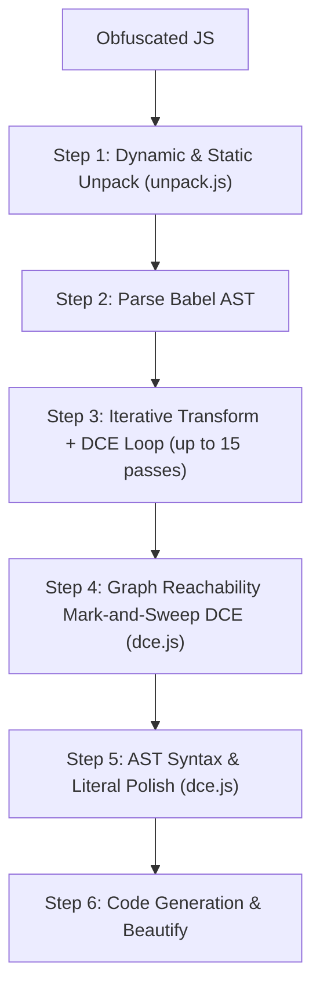

# JS-Confuser Deobfuscator

An AST-based JavaScript deobfuscator that reverses `js-confuser` obfuscation layers using `@babel/parser`, `@babel/traverse`, `@babel/types`, `@babel/generator`, and isolated Node.js `vm` contexts.

## Reversed Obfuscation Passes

The pipeline reverses all standard `js-confuser` presets (`low`, `medium`, `high`) and custom combinations:

* **Pack and RGF (`src/transforms/unpack.js`, `src/transforms/rgf.js`)**: Unwraps nested `new Function(...)` compilation layers, IIFE wrappers, and `eval` trampolines.
* **Moved Declarations (`src/transforms/moved-declarations.js`, `src/transforms/cff.js`)**: Restores hoisted declarations, `FunctionDeclaration`s, and `ClassDeclaration`s to their call-site definitions.
* **Constant Arrays and Duplicate Literals (`src/transforms/constant-arrays.js`)**: Inlines static literal arrays and deduplicated constant pools.
* **String Concealing, Encoding, and Splitting (`src/transforms/string-concealing.js`)**: Executes top-level and block-scoped Base91/UTF-8 string decoders in a sandboxed VM and folds split string concatenations.
* **AST Scrambler (`src/transforms/ast-scrambler.js`)**: Unrolls comma-expression chains and scrambled statement sequences.
* **Global Concealing (`src/transforms/global-concealing.js`)**: Resolves concealed global lookups (`globalThis`, `window`, `global`) back to direct global identifiers.
* **Calculator (`src/transforms/calculator.js`)**: Inlines arithmetic and binary operator dispatch functions.
* **Opaque Predicates (`src/transforms/opaque-predicates.js`)**: Evaluates constant predicate functions and prunes unreachable branches while hoisting `var` declarations.
* **Dispatcher (`src/transforms/dispatcher.js`)**: Extracts functions from object-based call dispatchers and rewrites call sites to direct calls.
* **Flatten (`src/transforms/flatten.js`)**: Unboxes flattened parameter/state objects and restores direct function signatures.
* **Control Flow Flattening (`src/transforms/cff.js`)**: Symbolically traces state-machine `while`/`switch` loops from outermost to innermost, unboxes nested CFF scope chains (`_scope_0 = {}`), and restores original parameters.
* **Variable Masking (`src/transforms/variable-masking.js`)**: Replaces rest-parameter and local array/object variable-masking stacks (`...mask`, `var mask = []`) with named parameters and local variables.
* **Graph Reachability DCE and AST Polish (`src/core/dce.js`)**: Runs directed-graph Mark-and-Sweep dead code elimination from live program roots, removes dead clones (`deadCode`), and normalizes member expressions, method keys, and literals.

## Pipeline Architecture



## Directory Structure

```text
js-confuser-deobfuscator/
├── deobfuscator.js                  # Main CLI and programmatic entry point
├── package.json                     # Dependencies (@babel/*, js-beautify, js-confuser)
├── src/
│   ├── core/
│   │   └── dce.js                   # Graph reachability Mark-and-Sweep DCE & polishAST
│   ├── transforms/
│   │   ├── ast-scrambler.js         # Sequence & statement unrolling
│   │   ├── calculator.js            # Binary/unary calculator function inlining
│   │   ├── cff.js                   # Multi-level CFF state machine & scope unboxing
│   │   ├── constant-arrays.js       # Constant array & literal pool inlining
│   │   ├── dispatcher.js            # Function dispatcher extraction
│   │   ├── flatten.js               # Flattened function wrapper unboxing
│   │   ├── global-concealing.js     # Global object lookup resolution
│   │   ├── moved-declarations.js    # Hoisted function declaration restoration
│   │   ├── opaque-predicates.js     # Opaque predicate evaluation & branch pruning
│   │   ├── rgf.js                   # new Function() RGF array inlining
│   │   ├── string-concealing.js     # Sandboxed VM string decoding & folding
│   │   ├── unpack.js                # Outer pack / IIFE / Function unpacking
│   │   └── variable-masking.js      # Rest & local array variable unmasking
│   └── utils/
│       └── ast-utils.js             # Constant expression evaluator & safeGlobals
└── test/
    ├── clarity-benchmark.js         # Deterministic 32-case AST clarity & execution benchmark
    └── comprehensive-test.js        # Live JS-Confuser end-to-end verification suite
```

## Usage

### Deobfuscate a File

```bash
node deobfuscator.js <input_file.js> <output_file.js>
```

### Run Verification Suites

Run the deterministic 32-case AST clarity and semantic equivalence benchmark:

```bash
node test/clarity-benchmark.js
```

Run the live `js-confuser` end-to-end test suite across all 4 test programs and 8 obfuscation configurations:

```bash
node test/comprehensive-test.js
```
